# Hellooo 👋 I'm Carson!
```
class Carson {
  private:
    int age = 22;
  public:
    vector<string> hobbies = { "Tennis", "Coding", "Ukulele", "Badminton", "Guitar" };
}
```

## Check Out My Website
<h3 align="center">
  👉 <a href="https://www.carsonsecrest.me/">www.carsonsecrest.me</a> 👈
</h3>

<p align="center">
  <a href="https://www.carsonsecrest.me/">
    
  </a>
</p>


## Projects

### Hackathon Wins 🏆
<div align="center">
<table>
  <tr>
    <td align="center" width="20%">
      <a href="https://quackhacks3.seufert.workers.dev">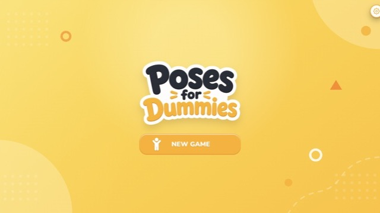</a><br>
      <b>🥉 Poses for Dummies</b><br>
      <sub><a href="https://quackhacks3.seufert.workers.dev">Live</a> · <a href="https://2026.quackhacks.org/projects/poses-for-dummies">Demo</a> · <a href="https://github.com/mileshs/quackhacks3">Repo</a></sub>
    </td>
    <td align="center" width="20%">
      <a href="https://judge.beaverhacks.org/cmlfqho300000kv04wi9199a5/projects/cmoq6kaau00yzjv04otw9fqd8">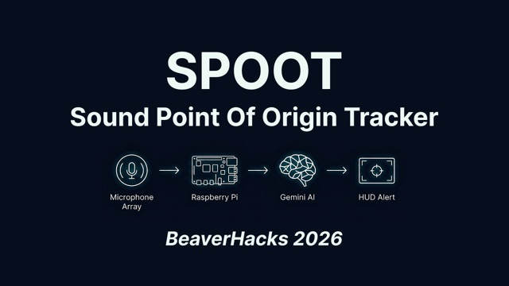</a><br>
      <b>🥉 SPOOT</b><br>
      <sub><a href="https://judge.beaverhacks.org/cmlfqho300000kv04wi9199a5/projects/cmoq6kaau00yzjv04otw9fqd8">Demo</a> · <a href="https://github.com/Jakhangir18/BeaverHacks-2026">Repo</a></sub>
    </td>
    <td align="center" width="20%">
      <a href="https://devpost.com/software/pursend">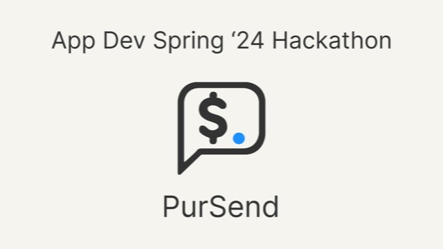</a><br>
      <b>🥇 PurSend</b><br>
      <sub><a href="https://devpost.com/software/pursend">Demo</a></sub>
    </td>
    <td align="center" width="20%">
      <a href="https://devpost.com/software/slumped-stats">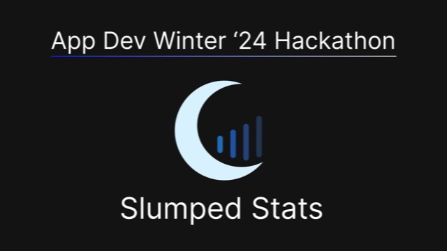</a><br>
      <b>🥈 Slumped Stats</b><br>
      <sub><a href="https://devpost.com/software/slumped-stats">Demo</a> · <a href="https://github.com/Carson274/Sleep-App">Repo</a></sub>
    </td>
    <td align="center" width="20%">
      <a href="https://devpost.com/software/box-office-battles">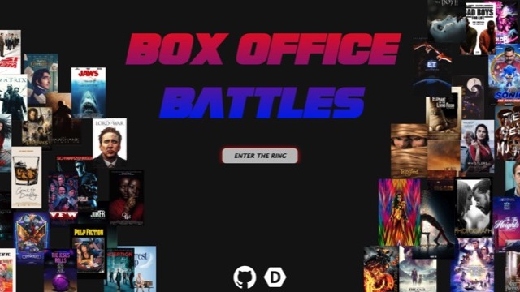</a><br>
      <b>🥈 Box Office Battles</b><br>
      <sub><a href="https://devpost.com/software/box-office-battles">Demo</a> · <a href="https://github.com/Carson274/Box-Office-Battles">Repo</a></sub>
    </td>
  </tr>
</table>
</div>

### Apps & Games
<div align="center">
<table>
  <tr>
    <td align="center" width="33%">
      <a href="https://carpetstudios.github.io">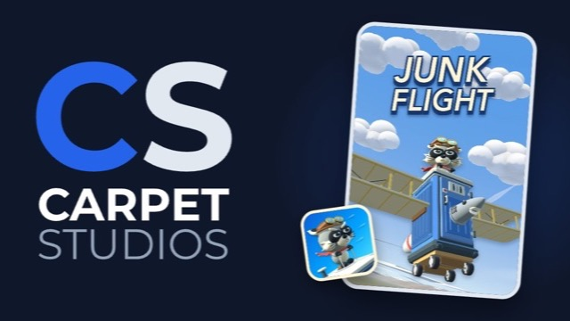</a><br>
      <b>Junk Flight</b><br>
      <sub><a href="https://carpetstudios.github.io">Site</a></sub>
    </td>
    <td align="center" width="33%">
      <a href="https://accent-guessr.vercel.app">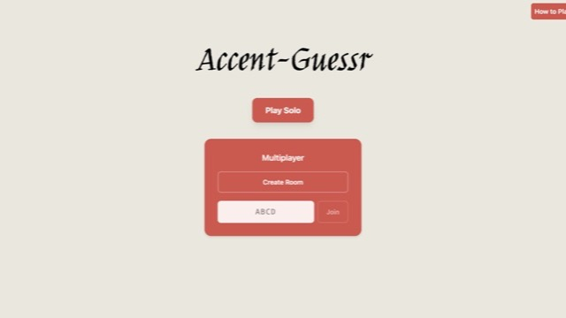</a><br>
      <b>Accent Guessr</b><br>
      <sub><a href="https://accent-guessr.vercel.app">Live</a> · <a href="https://github.com/Carson274/Accent-Guessr">Repo</a></sub>
    </td>
    <td align="center" width="33%">
      <a href="https://watch-your-sleep.vercel.app/">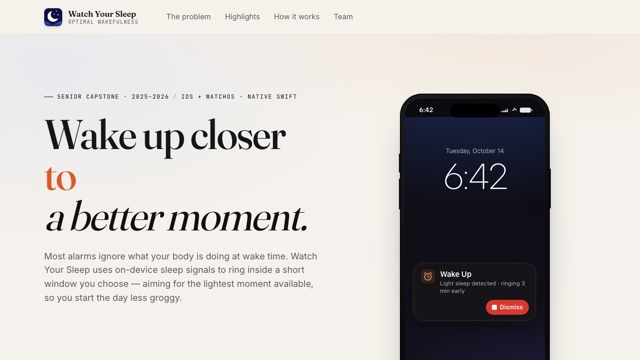</a><br>
      <b>Watch Your Sleep</b><br>
      <sub><a href="https://watch-your-sleep.vercel.app/">Site</a></sub>
    </td>
  </tr>
</table>
</div>
<div align="center">
<table>
  <tr>
    <td align="center" width="25%">
      <a href="https://beaverpurity.com/">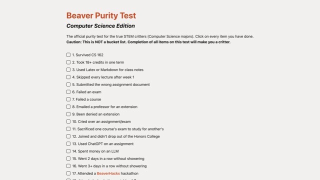</a><br>
      <b>Beaver CS Purity Test</b><br>
      <sub><a href="https://beaverpurity.com/">Live</a> · <a href="https://github.com/Carson274/BeaverCsPurity">Repo</a></sub>
    </td>
    <td align="center" width="25%">
      <a href="https://devpost.com/software/roll-call-brawl">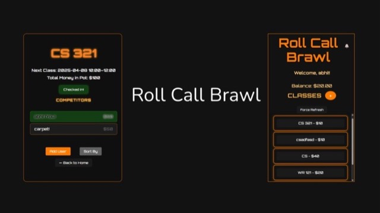</a><br>
      <b>Roll Call Brawl</b><br>
      <sub><a href="https://devpost.com/software/roll-call-brawl">Demo</a> · <a href="https://github.com/Carson274/Roll-Call-Brawl">Repo</a></sub>
    </td>
    <td align="center" width="25%">
      <a href="https://devpost.com/software/crowd-fjct15">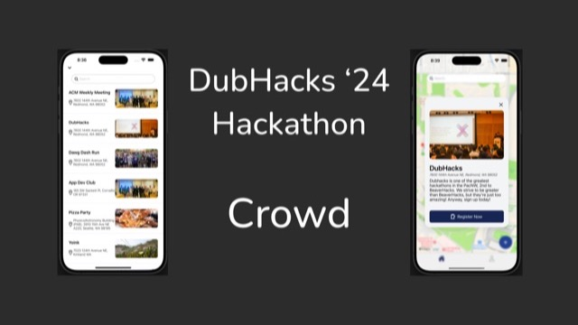</a><br>
      <b>Crowd</b><br>
      <sub><a href="https://devpost.com/software/crowd-fjct15">Demo</a> · <a href="https://github.com/sebat2004/crowd">Repo</a></sub>
    </td>
    <td align="center" width="25%">
      <a href="https://github.com/sebat2004/linguasketch">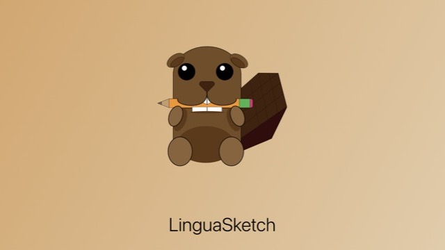</a><br>
      <b>LinguaSketch</b><br>
      <sub><a href="https://github.com/sebat2004/linguasketch">Repo</a></sub>
    </td>
  </tr>
</table>
</div>


## Credentials 💼

### Languages 🧠
[](https://skillicons.dev)

Also: **SQL**

### Frameworks and Libraries 🏗️
[](https://skillicons.dev)

Also: **React Native · MediaPipe · Playwright · React Testing Library**

### Databases 📁
[](https://skillicons.dev)

### Developer Tools ⚙️
[](https://skillicons.dev)

Also: **Claude Code · Spinnaker**
